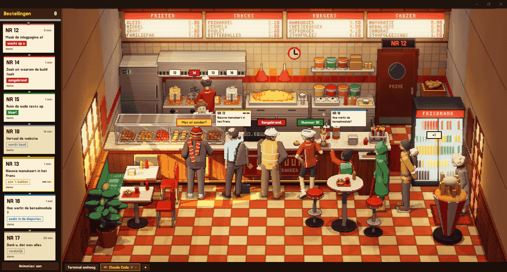

# Frituur

A Belgian frituur for [Herdr](https://herdr.dev). Every coding agent in your Herdr window is a customer
with a ticket number, and its work is the order being cooked behind the counter. You see at a glance
who is frying, who is waiting for you, and whose fries are going cold.



## Install

You need the Herdr desktop app and Python 3. Nothing else: the art is already baked.

1. Open Herdr once, so its folder exists (`~/.config/herdr-app`, also on Windows).
2. Get this repo and run the installer (`python3` on macOS and Linux):

   ```
   git clone https://github.com/Kaubes/frituur-herdr
   cd frituur-herdr
   python tools/install.py --hook --bel
   ```

3. In Herdr press `ctrl-shift-l` until the frituur shows, or run
   `herdr-app do layout.switch '{"name":"Frituur"}'`. The same key switches back to your own layout.

What the two options do, both optional:

| Option | What it adds | What it changes |
|---|---|---|
| `--hook` | The detailed states for Claude Code (freezer, shaking, tests, oil, burnt) | Copies one script to `~/.claude/hooks` and registers it in `~/.claude/settings.json`. A backup of that file is kept next to it. |
| `--bel` | A shop bell when an agent needs you | Sets Herdr's "blocked" sound in its `settings.json`. |

Without `--hook` every agent still shows, with Herdr's own four states. The hook only writes small
files under `~/.local/state/frituur` (ticket number, current activity, the first 40 characters of
your prompt). The mod runs no programs and uses no network.

To update: `git pull`, then the same install command. To remove: `python tools/install.py --unhook`,
then delete `mods/frituur`, `layouts/Frituur.json`, `layouts/Frituur.png` and `themes/Frituur.json`
from Herdr's folder.

Built and tested on Windows with Herdr 0.1.18. Nothing in it is Windows-only, but macOS and Linux
are untested.

## What you are looking at

| The agent is | In the frituur |
|---|---|
| Just opened, nothing asked yet | A customer walks in and looks at the menu |
| Thinking | A worker prepares at the fries bin |
| Reading or searching | A worker reaches into the freezer; raw fries in the basket |
| Editing files | The basket is down in the oil: bubbles and steam |
| Running commands | A worker shakes the basket |
| Running tests | A spark above the basket |
| Compacting its context | The oil is being changed |
| Hitting an error | Burnt fries and smoke: "Aangebrand." |
| Waiting for you | The customer leans in and asks "Welke saus?"; the bell rings |
| Finished | "Nummer 12!" and a steaming cone on the counter |
| Finished and ignored for 5 minutes | The cone goes cold |
| Idle after an order | The customer eats |
| Running subagents | One extra snack per subagent on the order bon |

The rail at the left has one paper bon per agent, the most urgent on top. Click a bon or a customer to
jump to that agent. The terminals are in a drawer you pull up over the shop.

| Key | Does |
|---|---|
| `ctrl-shift-j` | Drawer: closed, half, nearly full |
| `ctrl-shift-b` | Hide or show the order rail |
| `ctrl-shift-l` | Switch layout |

Try it without any agents: add `"demo": true` to the `props` of the `zaak` and `bonnen` blocks in
`layouts/Frituur.json` in Herdr's folder. `"demo": "rondje"` walks through every state.

## Changing it

Edit here, run `python tools/install.py`, and Herdr reloads. `herdr-app check mods/frituur` reports
mistakes.

| Path | What |
|---|---|
| `mods/frituur/*.js` | The mod: shop, order rail, tab bar, session state, every text (`tekst.js`) |
| `layouts/`, `themes/` | The window and its colours |
| `integrations/claude-code/` | The Claude Code hook |
| `tools/scene.py`, `people.py`, `props.py` | The room, the people, the food. Everything is drawn by script. |
| `tools/sprites.py` | Bakes all art into `mods/frituur/art` (about a minute; needs `numpy` and `Pillow`) |
| `RECIPE.md` | The brief another agent can rebuild this layout from |

## Credits

Font: Jersey 15 (SIL Open Font License, text included). The hook plumbing follows
[World of Codecraft](https://github.com/kevinpardo/world-of-codecraft) (MIT). The bell is synthesised.
No real brands appear in the shop.
