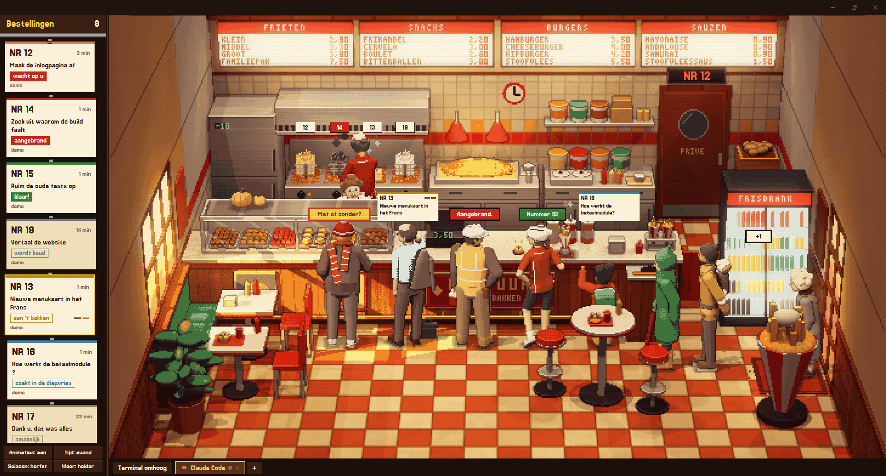

# Frituur

A Belgian frituur for Herdr. Every coding agent is a customer with a ticket number, its work is the
order being cooked behind the counter. The shop fills the window in pixel art; the terminal is a
drawer pulled up over it, and the orders hang as paper bons on a rail at the left.

## What you see

- **Order rail** (left, 230 px, full height): "Bestellingen" and a count, a steel rail, then one paper
  bon per agent, most urgent on top: `NR 12`, time in this state, the prompt's first 40 characters, a
  state word in its colour, a snack per subagent, space and tab. The focused agent's bon has a gold
  edge; cold and eaten orders are darker paper. At the bottom four small buttons, two by two: "Animaties", and
  "Tijd", "Seizoen", "Weer" (each shows `auto` or what is set; a click goes to the next choice).
- **Shop** (the rest): menu boards, ticket display, freezer, four-basket fryer, frietbak, sauces,
  counter with five customer spots, a two-person queue by the drinks fridge and a "+N" beyond that.
  Stage of 640x400 native pixels scaled to fit the window, hung from the top and clipped.
- **Drawer** (bottom, 420 px, resizable): the shown tab's terminals.
- **Bar** (bottom, 38 px): drawer handle, spaces (when more than one), tabs, + menu.

## How it behaves

- **A new agent** walks in from the door to the counter; when it ends, it walks out and the queue moves up.
- **working:** denkt (worker at the frietbak), diepvries (reading: worker at the freezer), bakt
  (editing: basket in the oil, bubbles, steam), schudt (commands: basket shakes), test (spark), olie
  (compacting: oil can). The basket's hood tag shows whose it is. A failed tool: burnt basket, smoke,
  "Aangebrand." for 7 s.
- **blocked:** the customer leans in, "Welke saus?", the bell flashes, a worker comes to the counter.
- **done:** "Nummer 12!" and a steaming cone; after 5 minutes the cone goes cold.
- **idle:** eats (after an order) or looks at the menu.
- **Idle life:** standing customers look up at the menu now and then, eating ones take a bite, workers blink, one
  wipes the counter, the other writes on his pad, the dog wags. Opacity loops only, each person on its own rhythm.
- **Time of day:** five baked lights. Morning (sun through the door), noon, evening (low orange sun through the
  window; the designed look), night (dark glass, lamps only), and grey for clouds, rain and snow by day. The hour
  picks one, with sunrise and sunset per month as in Belgium.
- **Season:** on top of the snack display tulips, a fan, pumpkins or a small Christmas tree; leaves by the door in
  autumn, fairy lights under the menu boards in winter.
- **Weather:** clear, clouds, rain, snow; made up from the date, the same for three hours. Rain and snow show on
  the glass of the window and the door; an umbrella stand or swept-up snow by the door.
- **By hand:** shared `frituur.tijd`, `frituur.seizoen`, `frituur.weer` (`auto` or a value), set by the buttons and
  by the commands of the same names; props `tijd`, `seizoen`, `weer` on the zaak block win. Prop `plaats`
  `[lat, lon]` asks the real weather from open-meteo.com twice an hour.
- **Two workers** go to the most urgent: blocked longest, errors, just finished, then latest activity.
- **Clicks:** a bon or customer focuses the agent and opens the drawer. Keys (`layout:Frituur`):
  ctrl-shift-j cycles the drawer (closed, 420 px, nearly full), ctrl-shift-b hides the rail.

## Built from

- **Tree:** row [`rail` block, `paal` block, `rechts` column [`vloer` column [`zaak` block, `main` tab block], `tabs` block]].
- **Mod** `frituur`, roles `zaak`, `bonnen`, `tabs`, `paal` by `props.role`; shipped `pane`, `menu`, `new-menu`.
- **herdr:** `agents`, `spaces`, `panes`, `layout`, `settings`, `shared`, `window`, `readTextFile`,
  `watchFolder`, `setAgentOrder`, `nextCommand`; commands `agent.focus`, `layout.show/hide/resize`,
  `space.select`, `tab.select/rename/close`.
- **Files read:** `~/.local/state/frituur/<terminal>.json`, written by the optional Claude Code hook.
  No programs run. No network, except open-meteo.com when the layout gives a `plaats`.
- **Art:** `tools/scene.py` (a small numpy ray tracer), `tools/people.py` and `tools/props.py` (people, food and tools:
  small models drawn with the room's camera, light and 96 colours), baked together by `tools/sprites.py`, once per light: `art/<scale>/<light>/`. Font: Jersey 15 (OFL). The plumbing follows World of Codecraft (MIT).

## Watch out

- Herdr smooths scaled images: draw a fractional scale from the next whole baked scale up, and snap to
  whole scales when close. Measure the height outside the drawer's column, or pulling it up zooms the shop.
- Hide the terminals to close the drawer; never shrink them to nothing.
- `line_height(n)` multiplies. `loop` only swings. Declare `transition` on every render.
- Very wide, low windows show plain wall colour at the sides.
- Without the hook an agent still shows, from Herdr's status only.
- The counter overlay also holds the floor, window and door: draw leaves and rain after it, not straight on the room.
- Every sprite has one size and anchor for all lights (cut to the same box), so the mod only swaps the folder.
- `loop`'s period is the whole swing; nest two opposite opacity loops to show an idle frame for a moment.

## Done when

- `herdr-app check mods/frituur` passes and `herdr-app status` shows no errors.
- `python tools/fake_sessions.py` says "all good".
- An agent that blocks rings the bell and tops the rail; one that ends walks out; a ninth shows "+N".
- ctrl-shift-j opens, enlarges and closes the drawer, and the room never moves.
- `herdr-app do frituur.tijd` steps through morning, noon, evening and night, and the whole shop relights.
